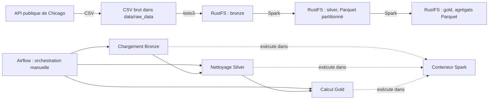

# Pipeline de données — trajets de taxis de Chicago

Ce dépôt met en place un pipeline local de traitement des trajets de taxis de Chicago. Il récupère un fichier CSV depuis l’API publique de la ville, le charge dans un stockage compatible S3 (RustFS), le nettoie et le partitionne avec Apache Spark, puis produit plusieurs agrégats analytiques.

## Architecture



Les services et leurs ports sont définis dans [docker-compose.yml](docker-compose.yml) :

| Service | Rôle | Adresse locale |
|---|---|---|
| Airflow | Interface et orchestration du DAG | [http://localhost:8081](http://localhost:8081) |
| RustFS | API de stockage S3 | [http://localhost:9000](http://localhost:9000) |
| RustFS Console | Interface d’administration du stockage | [http://localhost:9001](http://localhost:9001) |
| Spark | Environnement Python, Java et PySpark utilisé par les tâches | Pas de port publié |

Airflow utilise le socket Docker de l’hôte et lance les scripts dans le conteneur Spark déjà démarré. Le stockage RustFS est conservé dans `object-storage/`; les DAG, journaux et données brutes sont montés depuis les dossiers correspondants du dépôt.

## Organisation du dépôt

- [dags/etl_pipeline.py](dags/etl_pipeline.py) : DAG Airflow `chicago_taxi_pipeline` et dépendances entre tâches.
- [scripts/load_raw_data.py](scripts/load_raw_data.py) : téléchargement paginé du CSV depuis l’API de Chicago.
- [spark/src/bronze/extraction.py](spark/src/bronze/extraction.py) : création du bucket si nécessaire et chargement du CSV dans Bronze.
- [spark/src/silver/bronze_to_silver.py](spark/src/silver/bronze_to_silver.py) : déduplication, contrôles qualité, nettoyage et écriture Parquet dans Silver.
- [spark/src/gold/silver_to_gold.py](spark/src/gold/silver_to_gold.py) : calcul des jeux de données analytiques Gold.
- [spark/Dockerfile](spark/Dockerfile) et [spark/entrypoint.sh](spark/entrypoint.sh) : construction de l’image Spark et attente de disponibilité de RustFS.
- [airflow/Dockerfile](airflow/Dockerfile) : image Airflow avec le client Docker nécessaire aux tâches.
- [notebooks/data_exploration.ipynb](notebooks/data_exploration.ipynb) : exploration et nettoyage exploratoire du CSV avec PySpark.
- [.envexample](.envexample) : modèle de configuration des variables d’environnement.

## Prérequis

- Docker Engine démarré et plugin Docker Compose (`docker compose`).
- Connexion Internet lors du téléchargement des données et de la construction initiale des images et dépendances.
- Ressources suffisantes pour exécuter Docker, Java et Spark. Le traitement Silver est configuré avec deux cœurs et environ 2 Gio de mémoire pour le driver et l’exécuteur.
- Sous Linux, accès au socket Docker (`/var/run/docker.sock`) depuis Airflow et droits d’écriture dans les dossiers montés.
- Pour exécuter le téléchargeur depuis l’hôte : Python 3 et le paquet `requests`. Celui-ci n’est pas présent dans le [requirements.txt](requirements.txt) utilisé pour l’image Spark.

## Configuration

À la racine du dépôt, créez le fichier local `.env` à partir du modèle :

```bash
cp .envexample .env
```

Modifiez ensuite les identifiants RustFS et les chemins selon votre environnement. Ne publiez pas le fichier `.env` et remplacez les identifiants de démonstration avant toute utilisation non locale.

| Variable | Utilisation |
|---|---|
| `RUSTFS_USERNAME`, `RUSTFS_PASSWORD` | Identifiants RustFS utilisés par l’API et Spark. |
| `BUCKET_NAME` | Nom du bucket, actuellement `chicago-taxi-datalake`. |
| `BRONZE_OBJECT_KEY` | Clé S3 du CSV brut. |
| `SILVER_OBJECT_KEY` | Préfixe S3 des données Silver. |
| `GOLD_OBJECT_KEY` | Préfixe Gold prévu dans le modèle; les scripts écrivent actuellement dans des sous-chemins `gold/<nom_du_jeu>/`. |
| `S3_ENDPOINT` | Adresse de l’API S3 sur le réseau Compose, actuellement `http://object-storage:9000`. |
| `RAW_DATA_PATH` | Chemin du CSV vu par les conteneurs. Compose le redéfinit pour Spark en `/app/data/raw_data/chicago_taxi_trips_2020_2021.csv`. |

Le dossier local `data/` est monté à `/opt/airflow/data` dans Airflow et à `/app/data` dans Spark. Le CSV doit donc exister dans `data/raw_data/` sur l’hôte avant l’exécution du pipeline.

Sous Linux, si RustFS ne peut pas écrire dans son volume, le dépôt suggère de corriger les permissions du dossier `object-storage/` :

```bash
sudo chown -R 10001:10001 object-storage
```

Airflow doit également pouvoir écrire dans `logs/`. En cas de `PermissionError` sur ce volume, vérifiez l’UID de l’utilisateur Airflow de l’image (habituellement `50000`) et ajustez les permissions du dossier monté. La configuration Compose ajoute actuellement le groupe Docker `984`; cette valeur doit correspondre au groupe propriétaire du socket Docker sur votre hôte.

## Construction et démarrage

Depuis la racine du dépôt :

```bash
docker compose up -d --build
docker compose ps
```

La première construction de Spark installe Java 17 et les dépendances Python de [requirements.txt](requirements.txt), puis télécharge les bibliothèques Hadoop/S3A configurées dans le Dockerfile. Le service Spark reste actif en attente de commandes. RustFS démarre avec un volume local et Airflow expose son interface sur le port 8081 de l’hôte.


## Préparer le CSV brut

Le téléchargeur interroge l’API de Chicago par lots de 2 000 lignes, avec des tentatives répétées en cas d’erreur réseau et une reprise manuelle à l’aide de `LAST_TIMESTAMP`.

Avant de l’exécuter, corrigez les incohérences actuelles décrites dans la section [Points à vérifier](#points-à-vérifier). Installez la dépendance manquante sur l’hôte, puis lancez le script depuis la racine du dépôt :

```bash
python3 -m pip install requests
python3 scripts/load_raw_data.py
```

Le script écrit actuellement sous `data/raw_data/chicago_taxi_trips_2020_2023.csv`, alors que Compose et le DAG attendent `data/raw_data/chicago_taxi_trips_2020_2021.csv`. Le nom produit et les chemins attendus doivent être alignés avant de démarrer le DAG. Si un téléchargement précédent est incomplet, vérifiez le fichier et son horodatage de reprise avant de relancer afin d’éviter d’ajouter des données incorrectes.

## Exécution du pipeline

### Avec Airflow

1. Démarrez les services, puis ouvrez [http://localhost:8081](http://localhost:8081).
2. Connectez-vous avec les informations créées par Airflow standalone (le mot de passe initial est affiché dans les journaux du conteneur Airflow).
3. Vérifiez que le fichier attendu est visible dans le volume de données partagé et que la connexion Airflow `fs_default` permet au `FileSensor` de le trouver.
4. Activez et déclenchez manuellement le DAG `chicago_taxi_pipeline`.
5. Consultez les journaux de chaque tâche dans Airflow. Le DAG n’a pas de planification périodique (`schedule=None`) et le rattrapage est désactivé.

L’ordre des tâches est :

1. `wait_for_bronze_file` : attend le CSV (jusqu’à une heure, avec vérification toutes les 30 secondes).
2. `ingest_bronze` : exécute le transfert du CSV vers RustFS.
3. `create_silver` : nettoie et partitionne les données avec Spark.
4. `create_gold` : calcule les agrégats analytiques.


Chaque étape suppose que la précédente a réussi et que ses données de sortie sont disponibles dans RustFS.

## Traitements et sorties

### Bronze

Le script d’extraction crée le bucket configuré s’il n’existe pas et envoie le fichier local à la clé `BRONZE_OBJECT_KEY`. La clé fournie par le modèle est `bronze/chicago_taxi/trips_2020_2021.csv`.

### Silver

Le traitement applique un schéma explicite au CSV, compte les lignes, supprime les doublons, calcule le taux de valeurs nulles et retire les colonnes dont plus de la moitié des valeurs sont nulles. Il filtre les valeurs négatives de durée, distance et montants, calcule un total de contrôle, compte les écarts entre le total calculé et `trip_total`, puis ajoute des indicateurs de zone et de paiement potentiellement en espèces.

Les données sont écrites en Parquet sous `silver/taxi_data/`, partitionnées par année et mois (`year`, `month`). Les métriques sont écrites sous le préfixe `silver/taxi_data_metrics.json/` au format de sortie Spark (un répertoire contenant des fichiers de part).

### Gold

Le traitement lit Silver et produit les agrégats suivants sous `gold/` :

- `daily_trips` : nombre de trajets, distances et durées moyennes, tarif moyen et revenu quotidien.
- `popular_pickup_locations` et `popular_dropoff_locations` : activité et revenus par zone.
- `busy_hours` : activité et revenus par heure de départ.
- `companies_performance` : activité et revenus par compagnie.
- `profitable_taxis` : activité et revenus par taxi.
- `popular_payment_types` : activité et revenus par type de paiement.

Les jeux Gold sont écrits en Parquet et remplacés à chaque exécution (`mode("overwrite")`).

## Arrêt et nettoyage

Pour arrêter les services sans supprimer les données persistées :

```bash
docker compose down
```

Les dossiers `object-storage/`, `data/` et `logs/` sont des volumes locaux du dépôt. Ne les supprimez que si vous souhaitez également effacer les données correspondantes.

