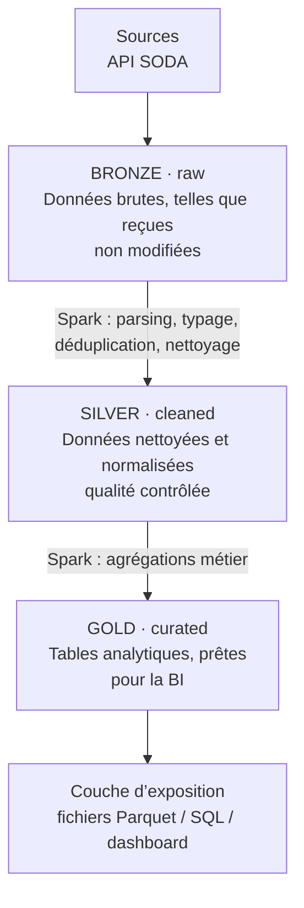
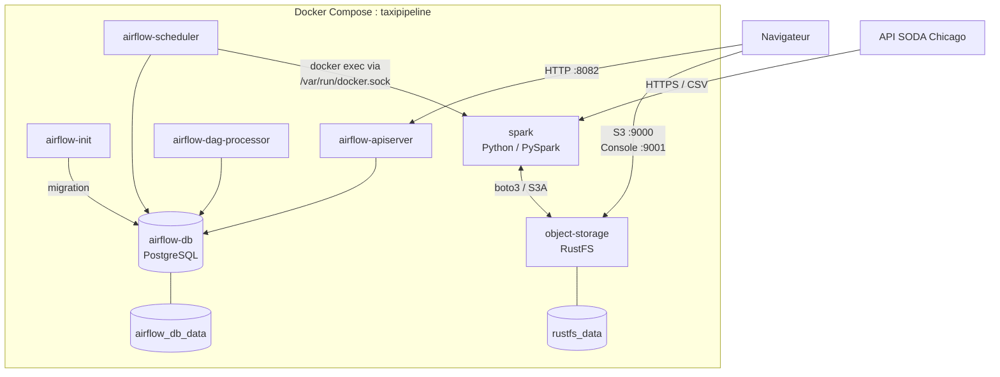

# Pipeline de données des taxis de Chicago

## Vue d’ensemble

Ce projet construit localement un pipeline de données sur les trajets de taxis de Chicago. Il extrait les données depuis l’API SODA de Chicago, les transforme avec Spark et les stocke dans RustFS, un stockage objet compatible S3.

Le résultat suit une architecture **Bronze → Silver → Gold** : des données brutes aux tables analytiques prêtes à être consommées.

## Architecture du pipeline



Airflow exécute le pipeline une fois par jour et déclenche les étapes dans cet ordre : ingestion Bronze, transformation Silver, puis agrégations Gold.

## Architecture des conteneurs



Les services du diagramme communiquent sur le réseau interne Docker ; seuls Airflow et RustFS publient des ports vers la machine hôte.

## Données : choix d’un trimestre

La source est le jeu de données des trajets de taxis de Chicago, accessible via l’API SODA.

Le périmètre retenu est un **trimestre de données** plutôt que l’historique complet. C’est un compromis entre :

- une période suffisamment longue pour analyser les variations entre mois, jours, heures, zones et moyens de paiement ;
- un volume raisonnable pour Spark et RustFS sur une machine locale ;
- des temps de téléchargement, de transformation et de débogage qui restent courts pendant le développement.

Un trimestre permet également d’écrire naturellement la couche Silver en partitions mensuelles. En revanche, il ne représente pas toutes les variations saisonnières d’une année entière : ce périmètre pourra être étendu lorsque l’infrastructure le permettra.

La fenêtre d’extraction est configurable avec `START_DATE` et `END_DATE`. Pour extraire le premier trimestre 2023, ajoutez à `.env` :

```dotenv
START_DATE=2023-01-01T00:00:00
END_DATE=2023-04-01T00:00:00
```

Sans ces variables, le script utilise une fenêtre de démonstration du 1er Janvier à 1er Avril 2023. `BATCH_SIZE` et `MAX_RETRIES` sont aussi configurables.


## Démarrer le projet

### Prérequis

- Docker Engine et Docker Compose ;
- accès Internet pour les images, les dépendances et l’API source ;
- mémoire suffisante pour Spark.

### Configuration et lancement

```bash
cp .envexample .env
openssl rand -hex 32
```

Copiez la valeur générée dans `AIRFLOW_JWT_SECRET` de `.env`, puis remplacez les identifiants de démonstration avant tout usage non local.

```bash
docker compose up -d --build
```

Lorsque `airflow-init` est terminé :

1. Ouvrez Airflow sur [http://localhost:8082](http://localhost:8082).
2. Connectez-vous avec `AIRFLOW_ADMIN_USER` et `AIRFLOW_ADMIN_PASSWORD` définis dans `.env`.
3. Le DAG `chicago_taxi_pipeline` s’exécute automatiquement une fois par jour ; vous pouvez aussi le déclencher manuellement pour lancer une première exécution immédiatement.
4. Consultez les données produites dans la console RustFS.

Le premier traitement télécharge déjà le CSV : aucun fichier source n’est à préparer manuellement. Lancez Compose depuis la racine du projet sans changer son nom (`-p`), car le DAG référence actuellement le conteneur Spark `taxipipeline-spark-1`.

Pour arrêter les services en conservant les données persistantes :

```bash
docker compose down
```

## Endpoints

| Service | Endpoint |
|---|---|
| Source — API SODA Chicago | `https://data.cityofchicago.org/resource/wrvz-psew.csv` |
| Airflow | [http://localhost:8082](http://localhost:8082) |
| RustFS — API S3 | [http://localhost:9000](http://localhost:9000) |
| RustFS — console | [http://localhost:9001](http://localhost:9001) |

## Structure du dépôt

```text
.
├── airflow/                 # Image et démarrage Airflow
├── dags/etl_pipeline.py     # Orchestration Bronze → Silver → Gold
├── docker-compose.yml       # Services locaux
├── notebooks/               # Exploration des données
├── spark/
│   └── src/
│       ├── bronze/          # Extraction depuis l’API et chargement S3
│       ├── silver/          # Nettoyage et normalisation
│       └── gold/            # Agrégations analytiques
├── .envexample              # Modèle de configuration locale
└── requirements.txt         # Dépendances Python Spark
```

## Choix de conception

### Pourquoi un seul DAG ?

Les trois étapes sont une chaîne de dépendances directe : Silver dépend de Bronze et Gold dépend de Silver. Un DAG unique permet de déclencher une exécution cohérente pour une même période, de visualiser les dépendances et de centraliser les journaux et les reprises dans Airflow.

Ce choix est adapté au périmètre actuel. Si l’ingestion devait être exécutée à une fréquence différente ou réutilisée par plusieurs pipelines, elle pourrait devenir un DAG séparé.

### Pourquoi RustFS plutôt que MinIO ?

Le besoin est un stockage objet local compatible S3, partagé par `boto3` (Bronze) et Spark S3A (Silver/Gold), sans compte cloud ni coût externe. RustFS et MinIO répondent tous deux à ce besoin avec la même API S3 : le code applicatif est identique, seuls l'image Docker et l'endpoint changent. Le choix s'est donc fait sur d'autres critères.

| Critère | RustFS | MinIO | Verdict |
|---|---|---|---|
| Licence | Apache 2.0 (permissive) | AGPLv3 (copyleft fort) | RustFS : aucune contrainte de redistribution |
| Pérennité de la version communautaire | Développement actif, communauté ouverte | Fonctionnalités retirées de l'édition communautaire, orientation vers l'offre commerciale | RustFS : moins de risque de dépendre d'un produit qui se ferme |
| Console d'administration | Complète, pratique pour inspecter les objets | Version communautaire amputée de plusieurs fonctions d'administration | RustFS |
| Maturité et robustesse | Projet récent, moins de retours en production | Très largement éprouvé | **MinIO** |
| Écosystème et documentation | Plus restreint | Très riche, nombreux guides | **MinIO** |
| Performances | Non déterminantes pour un pipeline local | Idem | Égalité |
| Coût de migration | Faible (même API S3) | Faible | Égalité |

#### Arbitrage

**Ce que l'on gagne :** une licence sans contrainte, un projet dont la version libre n'est pas appelée à se réduire, et une console qui remplit son rôle pendant le développement.

**Ce à quoi l'on renonce :** la maturité de MinIO et son écosystème. RustFS étant plus jeune, on accepte un risque de bugs ou de comportements non documentés.

**Pourquoi ce risque est acceptable ici :** le stockage sert uniquement à du développement local. Les données sont reproductibles à partir des sources, il n'y a pas d'exigence de disponibilité, et aucune donnée critique n'y réside.

**Réversibilité :** comme tout passe par l'API S3, revenir à MinIO (ou passer à AWS S3) ne demande que de changer l'endpoint et les identifiants, sans toucher au code des jobs.

**À réévaluer si :** le projet passe en production, si un besoin de support ou de haute disponibilité apparaît, ou si RustFS révèle des instabilités avec Spark S3A.

## Ce que j’améliorerais avec plus de temps

- Ajouter une vraie stratégie de tests : tests unitaires des transformations, tests d’intégration contre un bucket S3 de test et test de bout en bout du DAG.
- Remplacer le `docker exec` et le nom de conteneur fixé en dur par un opérateur Airflow ou un service de soumission Spark.
- Mettre en place une ingestion incrémentale avec un point de reprise, plutôt que de recharger une période complète.
- Épingler la version de RustFS, ajouter un healthcheck, des secrets gérés, TLS, des droits minimaux et des sauvegardes.
- Ajouter métriques, alertes et CI/CD ; faire évoluer ensuite le stockage et le cluster Spark pour un contexte de production.
